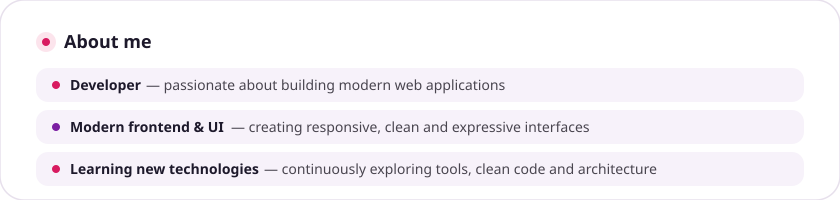
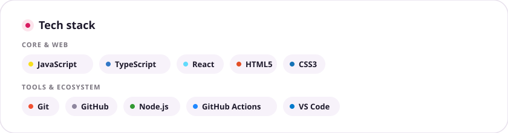
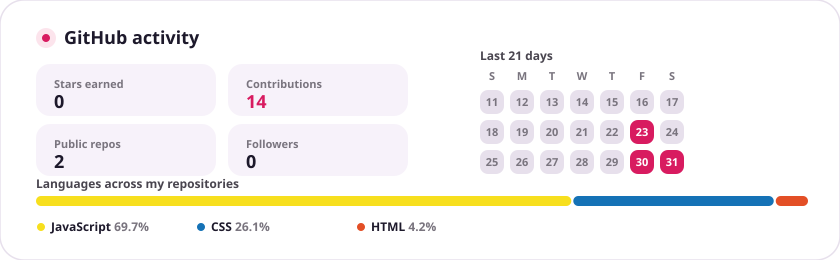
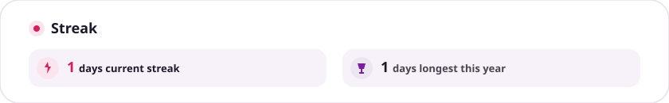

<!-- Hero Header -->
<picture>
  <source media="(prefers-color-scheme: dark)" srcset="assets/m3-hero-dark.svg">
  
</picture>

  

<!-- About Me -->
<picture>
  <source media="(prefers-color-scheme: dark)" srcset="assets/m3-about-dark.svg">
  
</picture>

  

<!-- Tech Stack -->
<picture>
  <source media="(prefers-color-scheme: dark)" srcset="assets/m3-stack-dark.svg">
  
</picture>

  

<!-- GitHub Activity -->
<picture>
  <source media="(prefers-color-scheme: dark)" srcset="assets/m3-stats-dark.svg">
  
</picture>

  

<!-- Streak -->
<picture>
  <source media="(prefers-color-scheme: dark)" srcset="assets/m3-streak-dark.svg">
  
</picture>

